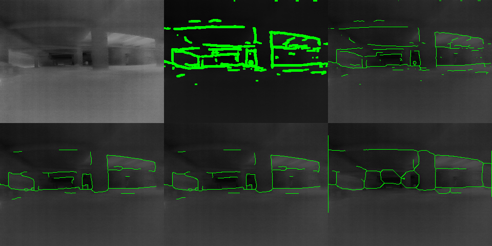
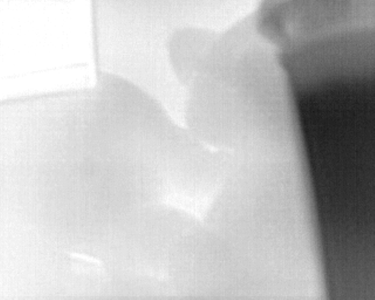
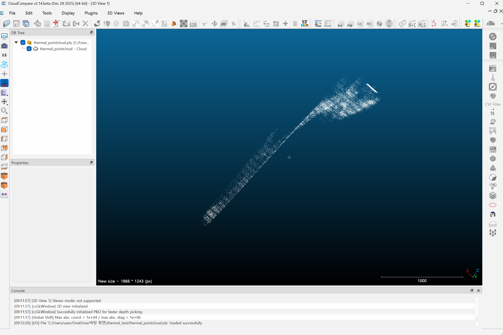
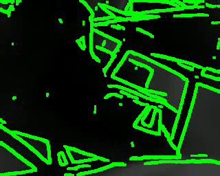
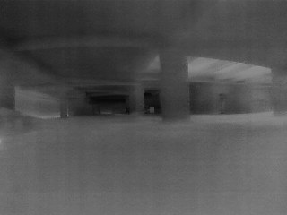
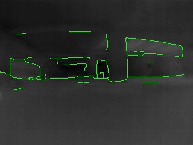
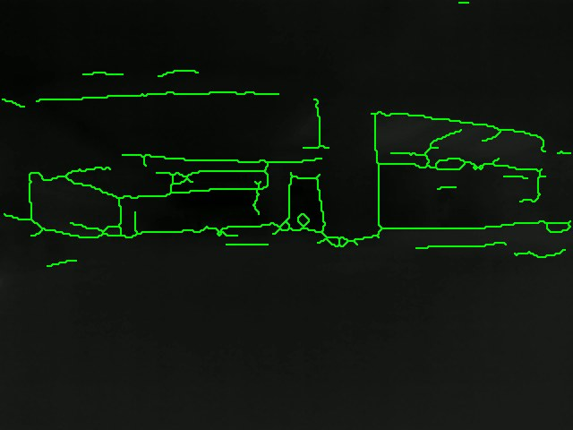
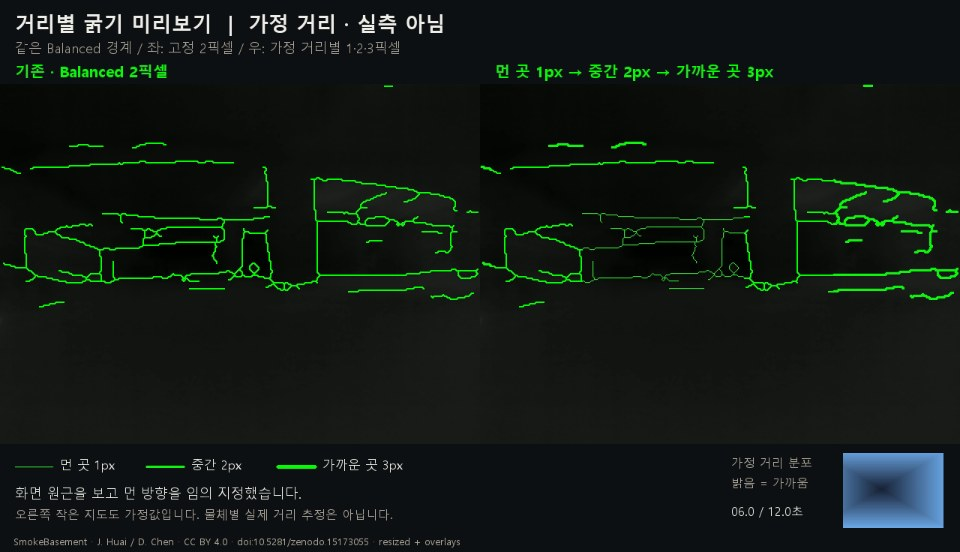
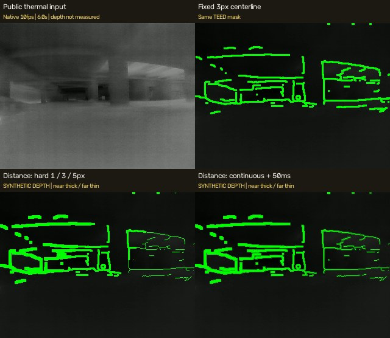

# Thermal Camera Research

**열화상 원본 수집부터 경계 표시, 센서 보정과 깊이 추정으로 이어지는 연구.**

농연 영상에서 벽·문틀·장애물의 경계를 읽기 쉽게 표시하는 방법을 탐색합니다. 기존 경계·거리 HUD 실험에 HaechiAR의 최신 Boson 촬영, 윤곽 안정화, 보정·센서 융합 작업을 연결해 정리했습니다.

[최신 진행](#최신-진행) · [연구 흐름](#연구-흐름) · [그림과 영상](#그림과-영상) · [검증 범위](#검증-범위) · [자료 안내](#자료-안내)

**업데이트 기준: 2026-10-23.** `firesight_sw/main`의 2026-10-15 반영본과 `calib/YSH`의 2026-09-24 개발본을 확인했습니다. [커밋·출처·반영 범위](UPSTREAM_STATUS.md)



**SmokeBasement 농연 영상의 경계 처리 비교.** 기존 TEED, 세선화, 구조 경계, 제한적 adaptation, PiDiNet의 화면을 비교합니다. 직접 Boson으로 촬영한 농연 실험은 아닙니다.

## 최신 진행

| 영역 | 최신 저장소에서 확인한 내용 | 현재 범위 |
|---|---|---|
| Boson 원본 촬영 | flirpy 기반 320×256 uint16 TIFF, 약 8.57 FPS 수집과 메타데이터 기록 | 비방사형 raw 카운트, 절대온도 아님 |
| 2차 촬영 · 10/14 | 열원·핫팩·식힘·이동을 포함한 18개 녹화 | 촬영 요약의 사용 가능 판정, 모델 평가 전 |
| 경계·HUD 개선 | 짧은 경계 제거, 시간·윤곽 안정화, 고온 색상 보존·빨간 외곽선 | 최신 CPU 시험의 전체 처리율 2.47–3.48 FPS |
| 깊이 추정 준비 | MonoTher-Depth, AnyThermal, RIDERS wrapper | 비교 실행을 위한 기반, 정량 우열 결과 없음 |
| Boson 내부 보정 | 원본 입력·촬영 → 보정 → 보고서 검토 → 사용자 승인 후 적용 | 실제 타깃·장비 반복 정확도 확인 필요 |
| 센서 융합 개발 | RGB-D+열화상, 열화상 AI, mmWave+열화상 수집·재생 구조 | `calib/YSH` 개발본, 합성 데모·소프트웨어 검사 |

원본 저장, 실제 센서 계측, 모델 평가를 구분합니다. 최신 기능과 이전 GPU benchmark는 장비·처리 경로가 달라 직접적인 성능 전후 비교로 사용하지 않습니다. [최신 내용과 출처](UPSTREAM_STATUS.md)

## 연구 흐름

```text
열화상 입력·원본 보존
  → 경계 검출과 표시: TEED · 세선화 · 안정화 · HUD
  → 보정과 시간·좌표 정합
  → 깊이 추정 / RGB-D·레이더 융합 실험
  → 표시 품질 · 지연 · 장비 조건별 평가
```

| 단계 | 이 저장소에서 볼 수 있는 자료 |
|---|---|
| 초기 입력 | 640×512 uint8 프레임과 표시·저장 코드 |
| 밝기 기반 점군 | 영상 밝기를 높이로 표현한 PLY 계산·검산 |
| 경계 선택 | 엣지 점유율, 구조 경계·세선화 비교 |
| 거리 HUD | 합성 거리의 연속 선 굵기와 EMA 실험 |
| 지속 처리 | 180초 CPU/CUDA 시험의 수치·영상 |
| 후속 개발 | HaechiAR 최신 작업 요약과 커밋 출처 |

## 그림과 영상

기존 이미지와 영상은 원래 파일·링크를 유지합니다. 영상 이미지를 누르면 해당 MP4가 열립니다.

### 초기 입력과 밝기 기반 점군



초기 계산 입력은 640×512 단일 채널 uint8입니다. 최신 Boson 320의 16-bit raw 촬영과 다른 입력입니다.



밝기를 높이로 바꾼 PLY 시각화입니다. 실제 깊이나 물체 표면의 3D 계측 결과는 아닙니다.

### Boson HUD 표시

[](public-media/boson-test.mp4)

초록 윤곽이 이미 합성된 표시 영상을 관찰한 기록입니다. [영상](public-media/boson-test.mp4)

### 농연 입력과 구조 경계

[](public-media/smoke-original.mp4)

모델 비교에 사용한 SmokeBasement 입력. [영상](public-media/smoke-original.mp4)

[](public-media/smoke-structural.mp4)

강한 구조와 연결된 경계를 선택하고 세선화한 TEED 출력. [영상](public-media/smoke-structural.mp4)

### 표시 폭과 거리 HUD

[](public-media/smoke-balanced-2px.mp4)

같은 확률맵에서 선택한 Balanced 경계를 최종 화면에 2px로 표시했습니다. [영상](public-media/smoke-balanced-2px.mp4)

[](public-media/distance-preview.mp4)

고정 2px와 임의 원근에 따른 1·2·3px 비교입니다. 사용한 거리는 실측값이 아닙니다. [영상](public-media/distance-preview.mp4)

[](public-media/realtime-comparison.mp4)

고정 폭·합성 거리 구간식·연속 폭·EMA를 비교합니다. [영상](public-media/realtime-comparison.mp4)

## 검증 범위

| 기록 | 확인한 결과 | 해석 |
|---|---|---|
| 기존 경계 비교 | TEED 점유율 12.27% → 구조 경계 1.51% | 화면 가림 지표, 검출 정확도 아님 |
| 합성 거리 실험 | 연속 폭 + EMA로 구간 경계의 폭 흔들림 감소 | 거리 입력을 가정한 표시 실험 |
| 9월 GPU 지속 처리 | CUDA / CUDA Graph에서 180초·약 30 FPS 기준 통과 | 해당 RTX PC와 호스트 처리 구간 |
| 10/8 최신 색상·윤곽 처리 | CPU 전체 2.47–3.48 FPS, 15/30 FPS 조건 미충족 | 다른 CPU·후처리·입력 조건 |
| 9/24 센서 융합 개발 | 보존 기록 107 passed, 3 skipped | 합성·개발 환경 검사, 실장비 성능 아님 |

이번 업데이트는 저장소 문서와 결과 기록의 대조입니다. 새로운 카메라 촬영·모델 학습·benchmark 실행은 수행하지 않았습니다.

## 자료 안내

- [최신 HaechiAR 작업과 출처](UPSTREAM_STATUS.md)
- [상세 연구 기록](RESEARCH_DETAILS.md): 기존 실험의 입력·방법·수치·해석 전체
- [입력](docs/01-inputs.md) · [처리 과정](docs/02-process.md) · [결과](docs/03-results.md) · [분석](docs/04-analysis.md)
- [코드 안내](code/README.md) · [영상 정보](MEDIA.md) · [검증 기록](VALIDATION.md)
- [데이터·환경 복원](DATA_AND_RESTORE.md) · [이전 보고서](RESEARCH_REPORT.md)

**출처.** Boson HUD를 제외한 공개 영상 5개는 SmokeBasement — Jianzhu Huai (2025), CC BY 4.0의 처리 파생물입니다. [원 데이터](https://doi.org/10.5281/zenodo.15173055) · [출처와 변환 내역](docs/SOURCE_CREDITS.md). TEED·PiDiNet과 각 깊이 모델은 외부 기반이며 팀 시스템과 개인 연구 기록의 범위를 구분합니다.

