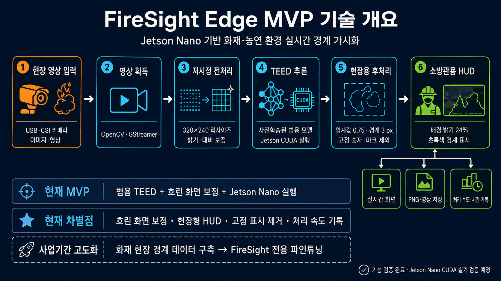

# FireSight Software

> 화재·농연 환경에서 시야가 제한된 소방관에게 사람과 구조물의 경계를 보여주기 위한
> Jetson Nano에서 바로 실행되는 현장 영상 처리 시제품

## 무엇을 만들고 있나

FireSight Edge는 일반 카메라 영상 또는 열화상 HUD 영상을 입력받아 저시정 환경의
화면을 선명하게 보정하고, 가벼운 경계 검출 모델인 TEED로 사람·장비·벽·문과 같은 윤곽을
추출해 초록색 HUD로 표시하는 것을 목표로 한다.

현재 MVP의 핵심은 화재를 자동 판정하거나 화점을 탐지하는 것이 아니다. 연기와 어둠
때문에 형태를 구분하기 어려운 현장에서 소방관이 주변 윤곽을 더 빠르게 인지할 수
있는지를 검증하는 실행 파이프라인이다.

## 전체 기술 구성



처리 흐름은 다음과 같다.

1. USB·CSI 카메라, 이미지 또는 영상에서 현장 프레임을 입력받는다.
2. OpenCV·GStreamer로 영상을 획득하고 `320×240`으로 리사이즈한다.
3. 밝기·대비 보정(CLAHE)으로 어둡고 흐린 부분을 선명하게 만든다.
4. 사전학습된 범용 TEED 모델로 윤곽선을 찾는다.
5. 약한 선을 제거하고 경계를 굵게 만든 뒤 화면의 고정 숫자·마크를 제외한다.
6. 원본을 24% 밝기로 낮춘 배경 위에 경계를 초록색으로 표시한다.

최종 결과는 화면 표시, PNG·영상 파일, FPS·지연시간 JSON으로 출력할 수 있도록
구성되어 있다. 화면 출력 기능이 실시간 처리 속도 충족을 의미하지는 않는다. Jetson Nano
CUDA 실기 성능과 실제 카메라부터 디스플레이까지의 지연은 아직 검증하지 않았다.

`edge/orin/`의 열화상 UI 개선 경로는 짧은 경계 제거, 시간·윤곽 안정화, 원본 고온 색상
보존과 빨간 외곽선을 지원한다. 현재 PC 측정에서 윤곽 안정화를 포함한 경로는 15/30 FPS
처리 조건을 충족하지 못했다. [실행 안내](edge/orin/README.md)와
[측정 범위 및 결과](docs/thermal_color_runtime_results.md)를 참고한다.

## 실제 열화상 HUD 처리 결과


위 이미지는 Fire360의 `IFSI Video 4` 열화상 HUD 프레임을 현재 코드로 직접 처리한
결과다. 소방관과 고온부, 우측 온도 컬러바가 함께 보이는 프레임을 사용했다.

| 단계 | 실제 처리 내용 |
| --- | --- |
| 열화상 HUD 원본 | Fire360에서 추출한 8-bit RGB 표시 프레임 입력 |
| 화면 선명화 | 밝기·대비 보정으로 열화상 영상의 형태를 더 잘 보이게 처리 |
| TEED 처리 | 사람과 주변 구조물의 윤곽선 탐색 |
| 현장용 화면 | 기관 마크·온도 숫자를 제외하고 초록색 경계 표시 |

이 입력은 실제 온도를 숫자로 측정할 수 있는 원본 열화상이 아니라, 열화상 카메라의
화면을 일반 이미지 형태로 저장한 영상이다. 따라서 현재 MVP는 온도 측정, 화점 탐지
또는 화재 위험도 판정을 수행하지 않는다.

## 현재 MVP와 고도화 방향

| 현재 구현 | 사업기간 고도화 |
| --- | --- |
| 사전학습된 범용 TEED 모델 사용 | 화재·농연 현장 데이터로 FireSight 전용 파인튜닝 |
| 어둡고 흐린 화면의 밝기·대비 보정 | 장면에 맞게 보정 강도 자동 조절 |
| Fire360의 고정 숫자·마크 제외 | 카메라별 고정 화면 표시 대응 |
| 초록색 현장용 경계 HUD | 소방관 사용성 평가를 반영한 HUD 개선 |
| PC에서 결과 재현 및 Jetson 실행 코드 | Jetson Nano 실제 장비에서 처리 속도 검증 |

현재의 차별점은 새로운 AI 모델 구조 자체가 아니라, 흐린 화면 보정·열화상 HUD 대응·
현장용 화면 표시·Jetson Nano 실행·처리 속도 기록을 하나의 가벼운 시스템으로 통합한
것이다. 자세한 기술 범위는 [MVP 기술 개요](docs/mvp_technical_overview.md)에서 확인할
수 있다.

## 저장소 구조

용도에 따라 데이터, 윤곽선 처리, 깊이 추정을 구분한다. 공통 문서와 실험·검증은
별도 폴더에 둔다.

| 폴더 | 분류 기준 |
| --- | --- |
| [data/](data/README.md) | 데이터 촬영 도구, 수집 기록, 로그·메타데이터, 원본 보관 안내 |
| [edge/](edge/README.md) | TEED 윤곽선 검출, HUD 표시, Jetson 실행 코드 |
| [depth/](depth/README.md) | 열화상 깊이 추정 모델과 입력 변환 코드 |
| [docs/](docs/) | 기술 설명, 참고 조사, 검증 보고서와 설명 이미지 |
| [experiments/](experiments/) | 비교 실험, 재현 스크립트와 회귀 검사 |

```text
data/
  capture/boson/   Boson 320 raw 녹화·점검 도구
  collection/     촬영계획·결과·로그·메타데이터와 원본 보관 안내
edge/
  teed/           Jetson Nano용 TEED 추론·HUD
  orin/           Jetson Orin용 윤곽선 처리·화면 표시
depth/
  monother_depth/ MonoTher-Depth 실행
  anythermal/     AnyThermal 실행
  riders/         열화상·레이더 깊이 추정 입력 준비 및 정렬
docs/             기술 설명·검증 보고서·이미지
experiments/      실험·비교·재현·회귀 검사
```

기존 `capture/`는 `data/capture/`로, `docs/data_collection/`은
`data/collection/`로 이동했다. 원본 프레임의 별도 보관 위치는
[데이터 수집 안내](data/collection/README.md)에서 확인한다.

설치, 카메라 연결, 이미지·영상 실행 방법은
[TEED 실행 안내](edge/teed/README.md)를 참고한다.
