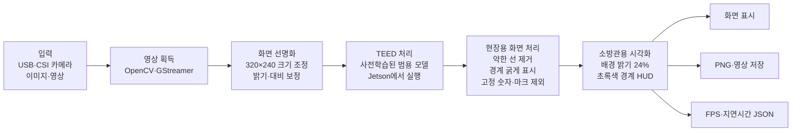
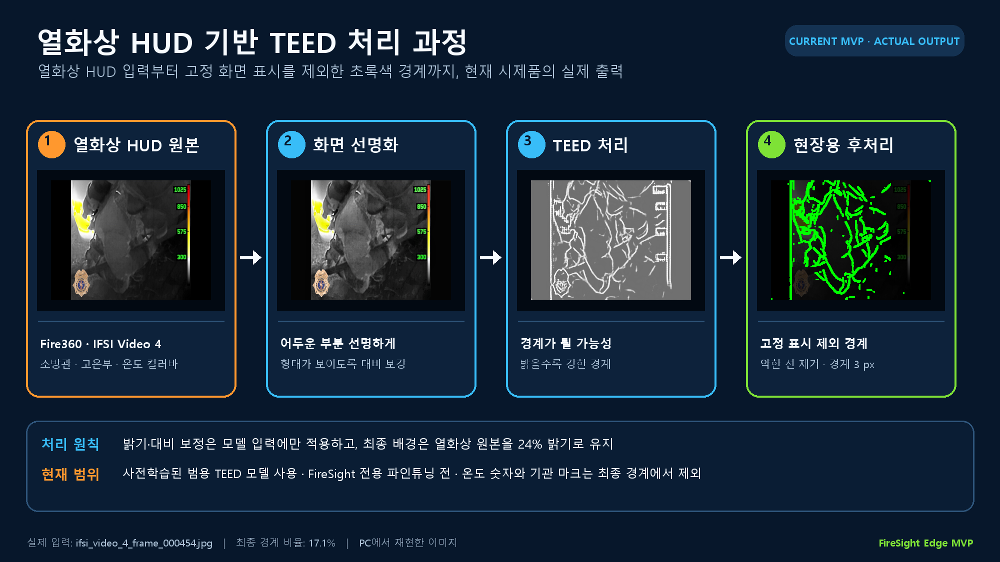

# FireSight Edge MVP 기술 개요

## 한 문장 정의

FireSight Edge MVP는 USB·CSI 카메라 또는 화재 현장 영상을 입력받아, Jetson Nano에서
TEED로 윤곽선을 추출하고 소방관이 확인하기 쉬운 초록색 화면으로 표시하는
Jetson Nano 현장 영상 처리 시스템이다.

## 데이터 흐름

## 실제 Fire360 열화상 HUD 처리 예시

사용한 입력은 Fire360의 열화상 HUD 프레임
`ifsi_video_4_frame_000454.jpg`이며 모든 단계는 현재 MVP의 기본값으로 재현했다.
밝기·대비 보정 결과는 모델 입력에만 사용하고 최종 화면 배경에는 원본 열화상 프레임을
사용한다. TEED 패널은 모델이 계산한 윤곽선의 강도를 보여주며, 마지막 패널은 약한 선을
제거하고 경계를 `3 px`로 굵게 만든 뒤 배경 밝기를 `24%`로 낮춘 출력이다. 최종
처리에서는 우측 온도 숫자와 좌측 기관 마크 영역의 경계를 제외한다.

각 단계의 원본 PNG는 `docs/fire360_stages/`에 별도로 저장되어 있다.

## 현재 MVP 구성

| 구분 | 구현 내용 |
| --- | --- |
| 입력 | USB 카메라, CSI 카메라, 이미지, 영상 |
| 추론 | TEED 모델, CPU/CUDA 자동 선택 |
| 흐린 화면 대응 | 모델 입력의 밝기·대비만 보정하고 원본 배경색 유지 |
| 시각화 | 어두운 원본 위에 초록색 3픽셀 경계 표시 |
| Fire360 대응 | 기관 로고와 온도 숫자 영역의 불필요한 경계 제외 |
| 출력 | HUD 화면 표시, PNG·영상, 성능 측정 JSON |
| 배포 | JetPack 4.x와 Python 3.6을 고려한 Jetson Nano 전용 코드 |

## 현재 차별점과 표현 범위

- 사전학습된 범용 TEED 모델을 사용한다.
- 아직 FireSight 현장에 맞춰 파인튜닝한 모델은 아니며, 화재·농연 환경과 Jetson Nano에
  맞춘 실행 시스템을 먼저 검증하는 단계다.
- 현재 차별점은 흐린 화면 보정, 현장용 초록색 표시, 고정 숫자·마크 제외, Jetson 실행,
  처리 속도 기록을 하나의 가벼운 시스템으로 통합한 데 있다.
- 화재 현장 윤곽선 학습 데이터 구축과 FireSight 전용 파인튜닝은 사업기간 고도화 항목이다.

## 검증 현황

- Fire360 다중 장면 비교 PNG 생성
- Fire360 열화상 HUD 샘플의 독립 실행, OSD 제외 및 초록색 경계 출력 확인
- Python 구문, 설치 스크립트 구문, 체크포인트 로딩 검증
- Jetson Nano CUDA 카메라 실기 성능과 실제 디스플레이 지연은 후속 검증 예정
- 화면 표시 기능이나 저장 영상의 재생 FPS를 실시간 처리 성능으로 해석하지 않는다.
- 이 개요와 위 도식은 `edge/teed/`의 기본 MVP 경로를 설명한다. 이후 `edge/orin/`에
  추가한 고온 색상 보존·윤곽 안정화 경로의 PC 측정은 15/30 FPS 조건을 충족하지 못했다.
  [최신 열화상 UI 실행 안내](../edge/orin/README.md)와
  [고온 색상 경로 측정 결과](thermal_color_runtime_results.md)를 참고한다.

## 제안서용 표현

> 사전학습된 범용 TEED 모델을 활용하되, 화재·농연 환경의 낮은 가시성과 현장
> 장비 제약을 고려한 화면 보정·경계 정리·Jetson Nano 실행 과정을 통합하여 소방관에게
> 구조물과 인체의 윤곽을 직관적인 초록색 화면으로 제공하는 현장 영상 처리 시제품
