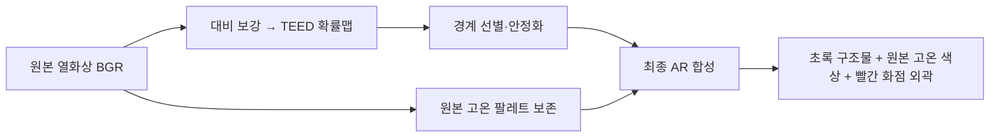

# 열화상 원본 고온 색상 보존과 빨간 외곽선

최신 사용자 요청은 **원본의 노랑·주황·빨강을 TEED 처리 과정에서 보존**하는 것이다. 일반 TEED 구조물은 초록색, 고온 영역 외곽은 빨간색으로 표시하며 내부의 카메라 고온 색상은 원본에서 그대로 합성한다. 직전 회색 내부 출력은 중간 산출물로 대체되었다.

## 동작

- 열화상 표시 영상임을 확인한 뒤 `--thermal-palette-overlay`로 활성화한다. 일반 RGB 기본값은 꺼짐이다.
- 원본 영상에서 따뜻한 색상 영역을 찾고 3×3 닫기/열기로 작은 틈과 점을 정리한다. 최소 연결 면적은 너비 720 px 기준 16 px²이며 해상도에 맞춰 조절한다. 작은 실제 고온 영역도 이 필터로 생략될 수 있다.
- 외곽선을 밝은 빨강(BGR 0,0,255)으로 그린다. 너비 720 px에서 3 px, 일반 윤곽 기본 두께는 1.5 px이다. 내부의 구멍에는 별도 등고선을 만들지 않는다. 빨간 외곽선 픽셀을 제외한 선택된 고온 색상 픽셀은 인코딩 전에 원본 BGR 값을 유지한다.
- 빨간 영역 내부와 작은 주변 여유 폭의 초록 선을 배경으로 되돌린다. 일반 배경은 원본을 어둡게 표시하고 `--see-through`에서는 검정이다. 고온 색상은 이 배경 감광과 별도로 보존한다. 임의의 단색 면을 만드는 대신 실제 카메라 팔레트를 사용한다.
- Fire360에서는 `--profiles edge/teed/profiles/fire360_video_profiles.json`을 함께 지정해 로고·온도 눈금의 고정 영역을 제외한다. 제외 영역에 의해 잘린 인공 경계도 빨간 선으로 그리지 않는다. 로고에 가려진 실제 물체의 형상은 복원하지 않는다.
- 등록된 Celsius 온도맵이 있으면 기존 온도 등온선 경로가 우선한다. 영상만으로는 실제 온도나 발화 지점을 확정하지 않으며 `TEMP N/A`를 유지한다.
- 움직임에 따른 TEED 확률 누적·윤곽 추적은 기존 설정을 사용한다. 빨간 영역에는 장기 잔상 누적을 추가하지 않았다. 검출 정확도나 화점 윤곽의 시간 안정성에 대한 정답 기반 평가는 이번 출력 검증과 별개다.

## 실행

저장소 루트에서:

```bash
python edge/orin/run_pipeline.py --source "../data/fire360/raw/IFSI Video 10 (2).mp4" \
  --device cpu --contour-edges --thermal-palette-overlay --profiles edge/teed/profiles/fire360_video_profiles.json \
  --display-width 720 --display-height 405 --pace
```

실제 투명 AR용 검정 배경은 `--see-through`를 추가한다. 전체 처리 성능 측정에서는 `--pace`와 녹화를 끈다. `--no-fire-highlight`는 빨간 외곽선도 끈다.

## 출력과 검증

최종 출력 디렉터리: `experiments/teed_ui/thermal_color_full`. `thermal_outline_full`은 이전 회색 내부 표시의 중간 결과다.

IFSI4/5/6/8/10은 이미 전체 프레임 검증을 마친 TEED 영상에 원본의 같은 번호 프레임에서 고온 색상과 빨간 외곽선을 재합성한다. IFSI7/9는 처음부터 끝까지 TEED 추론을 새로 실행한 뒤 원본의 동일 프레임에서 색상을 다시 합성한다. 재합성은 기존 선을 재추론하지 않으며 기존 VP8 디코딩·재인코딩 손실이 있다. 원본 영상과 가중치는 변경하지 않는다.

모든 영상은 소스의 첫 프레임부터 마지막까지 유지하고 29.97003fps 타임라인으로 저장한다. 출력 720×406에서 마지막 한 줄은 코덱용 검정 패딩이다. 오디오는 포함하지 않는다. 소스와 코드 해시, 순차 프레임 기록, 출력 전체 디코딩 검사는 각 영상 JSON에 저장한다.

- 실제 프레임 시각 비교: 로컬 생성 이미지 `experiments/teed_ui/thermal_color_full/ifsi10_thermal_colors_comparison.png`
- HUD/CLI 계약: 로컬 생성 기록 `experiments/teed_ui/thermal_color_full/integration_checks.json`
- 표시 구성 시각 판정: 로컬 생성 기록 `experiments/teed_ui/thermal_color_full/visual_verdict.json`

전체 영상 생성 후 별도 프로세스에서 측정한 최종 PC 처리율은 2.47–3.48 FPS였다. [측정 조건과 상세 결과](thermal_color_runtime_results.md)를 참고한다. 파일의 재생 FPS는 모델 또는 전체 파이프라인의 처리 FPS가 아니다. 실물 카메라/HMD/Jetson 측정은 포함하지 않는다.


## 단일 채널 TEED 출력에서 색상이 없어지는 이유와 수정 경로

TEED 확률맵은 각 위치의 경계 강도 한 값만 가진다. 그 맵 자체에서 카메라의 노랑/빨강을 복구할 수는 없다. 원본 BGR 프레임을 별도 경로로 보존하고, 경계 선별 결과와 같은 위치에 합성한다. 대비 보강/CLAHE는 모델 입력에만 적용하고 색상 레이어에는 적용하지 않는다.



## 전체 영상 완료 결과

7개 열화상 영상 모두 처음부터 끝까지 처리했다. 총 12,074프레임, 402.869초이며 모든 출력의 전체 디코딩·프레임 순서·원본/코드/출력 해시 검사가 통과했다.

| 영상 | 길이 | 프레임 | 전체 출력 |
| --- | ---: | ---: | --- |
| IFSI 4 | 20.85초 | 625 | 로컬 생성 `experiments/teed_ui/thermal_color_full/fire360_ifsi4_full_thermal_colors.webm` |
| IFSI 5 | 55.69초 | 1,669 | 로컬 생성 `experiments/teed_ui/thermal_color_full/fire360_ifsi5_full_thermal_colors.webm` |
| IFSI 6 | 71.84초 | 2,153 | 로컬 생성 `experiments/teed_ui/thermal_color_full/fire360_ifsi6_full_thermal_colors.webm` |
| IFSI 7 | 116.38초 | 3,488 | 로컬 생성 `experiments/teed_ui/thermal_color_full/fire360_ifsi7_full_thermal_colors.webm` |
| IFSI 8 | 22.06초 | 661 | 로컬 생성 `experiments/teed_ui/thermal_color_full/fire360_ifsi8_full_thermal_colors.webm` |
| IFSI 9 | 53.72초 | 1,610 | 로컬 생성 `experiments/teed_ui/thermal_color_full/fire360_ifsi9_full_thermal_colors.webm` |
| IFSI 10 | 62.33초 | 1,868 | 로컬 생성 `experiments/teed_ui/thermal_color_full/fire360_ifsi10_full_thermal_colors.webm` |

IFSI8에는 제외된 눈금·로고 밖에서 필터를 통과한 고온 팔레트 영역이 없어서 임의의 열 색상을 추가하지 않았다. 전체 검증 기록은 로컬 생성 기록 `experiments/teed_ui/thermal_color_full/verification.json`에 있다. 프레임 샘플과 고온 구간을 원본과 비교해 색상·위치·테두리를 확인했으며, 이를 장애물 회피 성능이나 실제 발화 판별 정확도 검증으로 해석하지 않는다. 위 WebM·PNG·JSON은 GitHub 배포 대상이 아니다.
